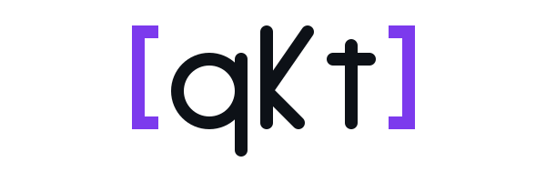
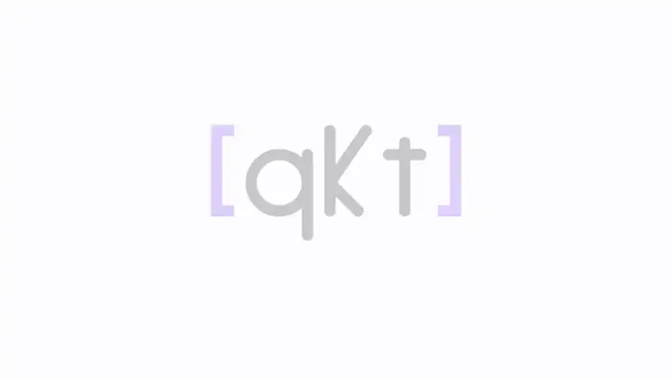

<p align="center">
  <picture>
    
  </picture>
</p>

<h3 align="center">Write a trading strategy in one small file.<br/>Backtest it, then run the same file live.</h3>

<p align="center">
  <a href="https://github.com/elitekaycy/qkt/actions/workflows/check.yml"></a>
  <a href="https://github.com/elitekaycy/qkt/releases/latest"></a>
  <a href="LICENSE"></a>
  <a href="https://github.com/sponsors/elitekaycy"></a>
</p>

<p align="center">
  <a href="docs/assets/qkt-full-dark.mp4">
    <picture>
      <source media="(prefers-color-scheme: dark)" srcset="docs/assets/qkt-loop-dark.webp">
      
    </picture>
  </a>
</p>

<p align="center"><sub>Every command in this clip was run for real, offline.<br/><a href="docs/assets/qkt-full-dark.mp4">Watch the full walkthrough</a></sub></p>

<br/>

## What it is

qkt is an event-driven trading engine in Kotlin. A strategy is a single `.qkt` file of symbols, indicators and
`WHEN ... THEN ...` rules. The same file, through the same pipeline, runs in backtest, on a paper broker and
live. Time, ids and randomness are injected, so identical inputs give identical trades.

```text
.qkt file ──▶ qkt ──▶ mt5-gateway ──────▶ MT5 brokers
                 ├──▶ qkt-venue-gateway ─▶ futures, options
                 ├──▶ qkt-guardrails      (risk halts)
                 └──▶ qkt-insights        (dashboard)
```

It trades CFDs, futures, perpetuals and options. Backtest and live differences are listed, not hidden, in the
[parity register](docs/parity/backtest-vs-live.md).

<br/>

## Quick start

**1. Install**

Download the Linux build from the [latest release](https://github.com/elitekaycy/qkt/releases/latest) (it
bundles Java). Windows, Docker and source are in the [install guide](docs/get-started/install.md).

```bash
tar xzf qkt-*-linux-x64.tar.gz
export PATH="$PWD/qkt/bin:$PATH"
qkt --version
```

**2. Write a strategy**

```bash
cat > momentum.qkt <<'QKT'
STRATEGY momentum VERSION 1
SYMBOLS
    btc = BACKTEST:BTCUSD EVERY 15m
RULES
    WHEN ema(btc.close, 9) CROSSES ABOVE ema(btc.close, 21)
     AND POSITION.btc = 0
    THEN BUY btc SIZING 0.1
     BRACKET { STOP_LOSS BY 1.0 PCT, TAKE_PROFIT BY 2.0 PCT }
QKT
qkt parse momentum.qkt
```

**3. Backtest it**

```bash
qkt backtest momentum.qkt --from 2026-08-01 --to 2026-09-01
```

Missing days are downloaded once from Dukascopy and cached.

**4. Read the result**

You will see a `Result` block with `Profit`, `Round trips`, `Worst drop` and `Sharpe ratio`, and a saved
`report.html`. That is a complete run. The figures are hypothetical: this backtest fills at the middle price and
models no costs. Add `--broker mt5-sim` for a fill model with spread and slippage.

When you are ready to go further, `qkt run momentum.qkt` paper-trades the same file in the foreground.

<br/>

## Next

| I want to | Read |
| --- | --- |
| Follow a longer first run | [Quickstart](QUICKSTART.md) |
| Learn the language | [DSL grammar](docs/reference/dsl-grammar.md) · [Indicators](docs/reference/dsl/indicators.md) |
| See more strategies | [Examples](docs/examples/index.md) |
| Look up a command | [CLI reference](docs/reference/cli-commands.md) |
| Bring my own data | [Backtest data](docs/how-to/backtest-data.md) |
| Trade CFDs, futures or options | [Instruments](docs/instruments/cfds.md) · [Deploy MT5](docs/get-started/deploy-mt5.md) |
| Compare with other tools | [Why qkt](docs/concepts/why-qkt.md) |
| Understand the design | [Architecture](docs/concepts/architecture.md) · [Determinism](docs/concepts/determinism.md) |
| Set up my editor | [Editor integrations](docs/how-to/editor-integrations.md) |
| Contribute | [CONTRIBUTING.md](CONTRIBUTING.md) · [Code structure](docs/contributing/code-structure.md) |
| Report a security issue | [SECURITY.md](SECURITY.md) |

<br/>

<sub>Pre-1.0: breaking changes can land in minor releases (see the [release process](docs/release-process.md)). Apache 2.0 licensed.</sub>
